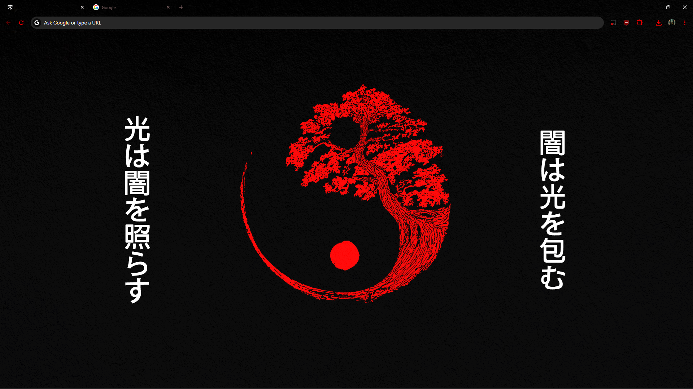
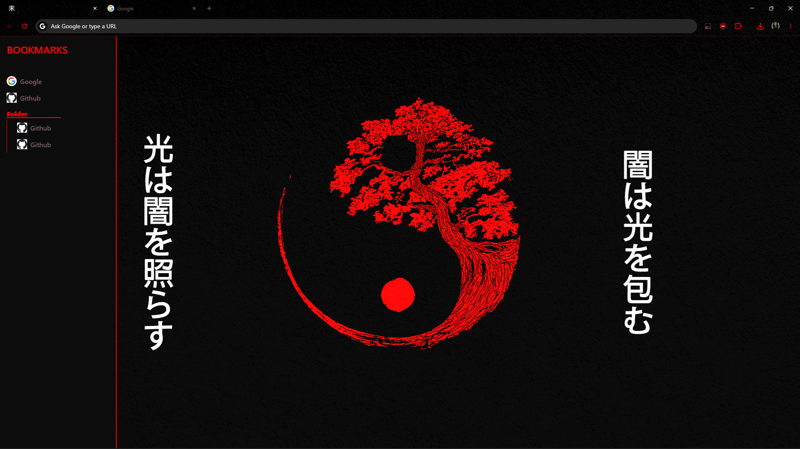
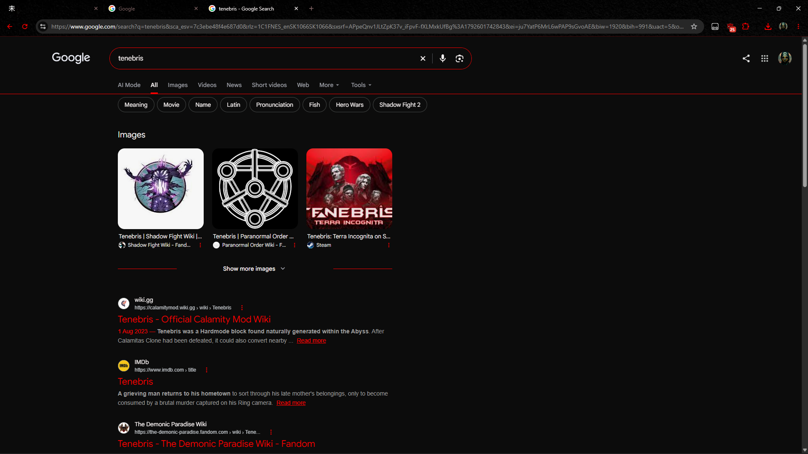

  

<h1 align="center">TENEBRIS</h1>

  <em>A quieter web. A darker interface.</em>

 Minimalist browser extensions for a cleaner new tab and a more cohesive search experience.

  🌑<code>MINIMALIST</code> · <code>DARK</code>🌑

 

## Overview

TENEBRIS is a collection of 2 extensions. A theme that overrides the default colors in the browser
and an extension that replaces the new tab and also the search results page.

- **New Tab** — A minimal, distraction-free starting point for your browser.
- **Search** — A redesigned search results page that brings the same visual language to your searches.
- **Bookmarks bar** — the new tab page contains custom bookmarks sidebar if the user hovers on the left side of the screen
- **All bookmarks** — if the user hovers on the right side instead, all bookmarks are shown

## Preview

    

      <h3>New Tab</h3>
      
    

    

      <h3>Bookmarks</h3>
      
    

    

      <h3>Search results</h3>
      
    

## Design Philosophy

- **Minimalism** — Only what matters, nothing more.
- **Atmosphere** — A restrained dark aesthetic designed for everyday use.

---

  Made for a quieter corner of the internet.

